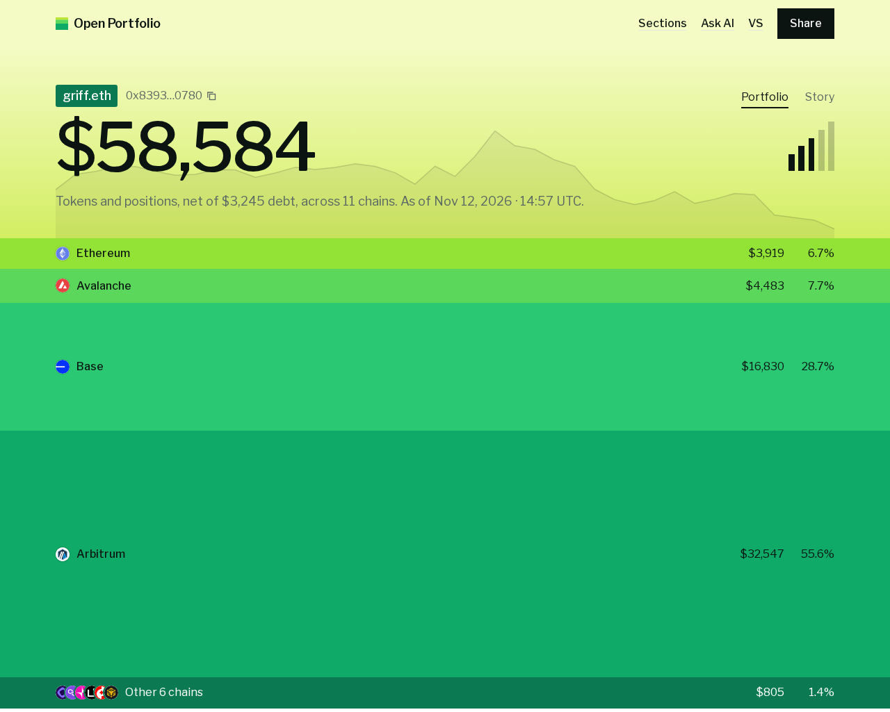
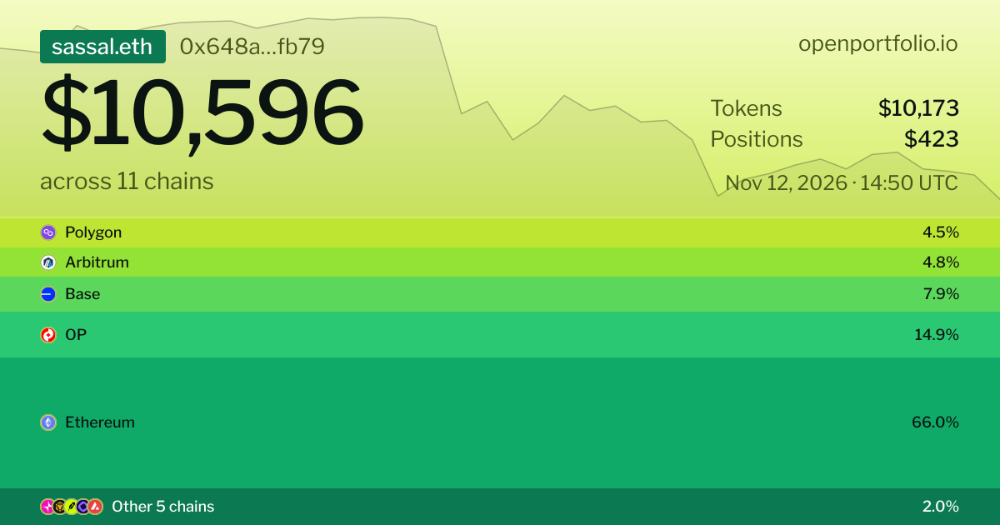
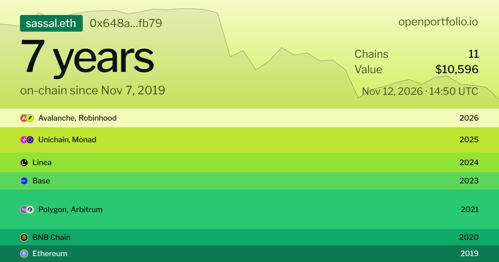
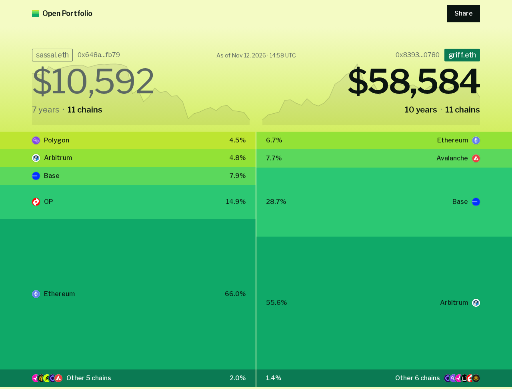
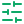

<p align="center">
  
</p>

# Open Portfolio

See any EVM wallet in layers, built on the public [Chaintable API](https://docs.chaintable.com/reference/openapi.md). Paste an address or ENS name to get a shareable breakdown of total value, seven-day trend, per-chain layers, tokens, DeFi positions, and on-chain history.

*Independent open-source project — no sign-in, and no configuration required to deploy.*

[Live App](https://openportfolio.io) · [Coverage](https://openportfolio.io/coverage) · [llms.txt](https://openportfolio.io/llms.txt) · [Chaintable API](https://docs.chaintable.com/reference/openapi.md) · [Deploy with Vercel](https://vercel.com/new/clone?repository-url=https://github.com/haimingx/open-portfolio)



##  Quickstart

[](https://vercel.com/new/clone?repository-url=https://github.com/haimingx/open-portfolio)

Or run locally (requires Node.js 20.9 or later):

```bash
npm install
npm run dev
```

<details>
<summary><strong>Development &amp; verification commands</strong></summary>

```bash
npm test                                                       # unit tests
npm run test:e2e                                               # browser tests against a local mock API (first run: npx playwright install chromium)
npm run lint
npm run typecheck
npm run build
npx tsx --conditions=react-server scripts/smoke.ts [address]   # read a real wallet
```

</details>

##  What's Included

<table width="100%" style="border-collapse: collapse; border: none;">
  <tr style="border: none;">
    <td width="33%" valign="top" style="border: none; padding: 6px;">
      <h4>Layered Chain View</h4>
      <p style="font-size: 0.9em; line-height: 1.4;">Total value with its last seven days drawn behind it, a proportional layer per chain, and small chains folded at the bottom.</p>
    </td>
    <td width="33%" valign="top" style="border: none; padding: 6px;">
      <h4>Tokens &amp; DeFi Positions</h4>
      <p style="font-size: 0.9em; line-height: 1.4;">Native coins, exchange-listed tokens, and parsed DeFi positions with cross-chain merging and ENS / CCIP-Read resolution.</p>
    </td>
    <td width="33%" valign="top" style="border: none; padding: 6px;">
      <h4>Story &amp; Share Cards</h4>
      <p style="font-size: 0.9em; line-height: 1.4;">Switch between holdings and on-chain history; generate 1200×630 or 2× PNG cards and GitHub README embeds.</p>
    </td>
  </tr>
  <tr style="border: none;">
    <td width="33%" valign="top" style="border: none; padding: 6px;">
      <h4>Side-by-Side Comparison</h4>
      <p style="font-size: 0.9em; line-height: 1.4;">Compare any two wallets at <code>/&lt;wallet&gt;/vs/&lt;wallet&gt;</code> with mirrored seven-day trends, chains, and share cards.</p>
    </td>
    <td width="33%" valign="top" style="border: none; padding: 6px;">
      <h4>AI-Ready Endpoints</h4>
      <p style="font-size: 0.9em; line-height: 1.4;">One-click Ask AI for ChatGPT &amp; Claude, plus structured <code>/intro.md</code>, <code>/history.json</code>, and <code>/llms.txt</code>.</p>
    </td>
    <td width="33%" valign="top" style="border: none; padding: 6px;">
      <h4>Zero-Config Deployment</h4>
      <p style="font-size: 0.9em; line-height: 1.4;">Runs out of the box with no sign-in or keys; optionally add a Chaintable API key, Redis trending, and WAF limits.</p>
    </td>
  </tr>
</table>

ENS names resolve through the ENS Universal Resolver on Ethereum using the same Chaintable API. Offchain names (CCIP-Read), such as `.base.eth` names, resolve too.

##  Sharing & Comparison

The address bar always holds the current view, so a copied link opens exactly what you see:

| Parameter | Values | Effect |
| :--- | :--- | :--- |
| `chain` | A chain id, or `other` | Shows one chain, or the folded small chains |
| `hide` | `chains`, `tokens`, `positions` (comma separated) | Hides sections |
| `card` | `vivid` (default), `soft`, `fade`, `blend`; `story` or `story-<style>` | Sets the page palette, content mode, and share card |

**Portfolio** shows what a wallet holds. **Story** shows how long it has been on-chain and the year it first reached each chain. The switch on the page and the one in the share dialog are the same choice, and a story always covers the whole wallet.

<p>
  
  
</p>

The share dialog copies the link or the image, posts to X, downloads the card, and copies an embed snippet that also works in a GitHub README. Each wallet serves its card at `/<address or name>/card?card=<card>`, which social previews use: `1200×630`, or `2400×1260` with `&scale=2`.

### Compare two wallets



`/<wallet>/vs/<wallet>` puts two wallets side by side: value, time on-chain, and chains, with the side that is ahead on each marked. Open it from **VS** in the wallet page's top bar. The share dialog offers the same layouts and styles as a single wallet, and the card is served at `/<wallet>/vs/<wallet>/card?card=<style>`.

##  AI Agents

| Entry point | Purpose |
| :--- | :--- |
| **Ask AI** (wallet page) | Opens ChatGPT or Claude with a prompt linking the wallet and requesting a reply in the browser's language, or copies the full wallet context to paste anywhere. The site calls no model. |
| `/<address or name>/intro.md` | Markdown version of the wallet page: total, chains, tokens, positions, largest holding and debt, story, counting rules, and source tables. Reads the same cached data as the page, declared via `<link rel="alternate">`, and served as `text/plain` (ChatGPT's page reader rejects `text/markdown` here). |
| `/<address or name>/history.json` | Wallet total at each four-hour mark of the last seven days so assistants can describe the trend rather than a single number. |
| [`/llms.txt`](https://openportfolio.io/llms.txt) | Describes all pages, parameters, and counting rules using the deployment's own domain. |
| [Chaintable CLI](https://github.com/haimingx/chaintable-cli) | For raw on-chain data, includes a local MCP server (`chaintable mcp`). |

##  How Values Are Counted

```text
total = native coins + tokens on the allowlist + net value of DeFi positions
```

- Tokens outside the allowlist are left out.
- A token that is also a pool is counted once, as a position.
- Prices come from the data source. Thinly traded tokens can show a value that could not be realized.
- A token with no price shows `—` and counts as zero. A price of zero is shown as `$0`.
- If a chain cannot be read, the page says so and the total leaves that chain out.

The [Coverage](https://openportfolio.io/coverage) page lists the chains, the named DeFi protocols, and every counted token, with search by symbol or contract address. Positions read by parsers without a protocol name, such as ERC-4626 vaults, count too.

> [!NOTE]
> Values are estimates from public on-chain data, not financial advice.

##  Configuration

Everything is optional. See [`.env.example`](.env.example).

| Variable | Purpose |
| :--- | :--- |
| `CHAINTABLE_API_KEY` | Dedicated API key from [chaintable.com](https://chaintable.com) to lift anonymous per-IP limits |
| `KV_REST_API_URL`, `KV_REST_API_TOKEN` | Upstash Redis credentials injected by Vercel Storage for home-page trending |
| `UPSTASH_REDIS_REST_URL`, `UPSTASH_REDIS_REST_TOKEN` | Direct Upstash Redis credentials when not using the Vercel integration |
| `TRENDING_EXCLUDE` | Comma-separated addresses to keep off the trending ranking |

### Chaintable API key

Without a key, requests are anonymous and limited per IP, which suits local development and small deployments. For a public site, create a key on [chaintable.com](https://chaintable.com) and add `CHAINTABLE_API_KEY` in your Vercel project.

Add it to the **Production** environment only, so branch and pull request previews cannot read it. Usage is charged to the account that owns the key, and the site falls back to anonymous requests when that account is out of credit.

### Trending ranking

The home page ranks wallets by how many people open them. It needs Redis, and shows decorative layers until connected.

1. In your Vercel project, open **Storage** and add **Upstash for Redis**. The free plan is enough to start. Pick the primary region closest to your function region (Tokyo, `ap-northeast-1`, for the default `hnd1`); read regions are not needed.
2. Connect it to the project and **leave Custom Prefix empty**.
3. Redeploy.

> [!TIP]
> The app reads `KV_REST_API_URL` and `KV_REST_API_TOKEN` directly, so setting a **Custom Prefix** in Vercel Storage silently turns trending off without an error.

A wallet appears after at least two visitors, and the ranking refreshes every few minutes. Each visitor counts once per wallet per UTC day using a hash of IP address and user agent with a daily rotating salt — no cookies are set and no IP addresses are stored. Counts are reported by the browser so crawlers and link previews are excluded. Because visits can be scripted, use `TRENDING_EXCLUDE` to remove an address.

### Rate limiting

Opening a wallet that has not been read recently runs a full data read, and a new ENS name costs a lookup. On a public site, add a [Vercel WAF rate limit](https://vercel.com/docs/vercel-firewall/vercel-waf/rate-limiting) by IP covering address and name paths, their cards, Markdown versions, and comparisons:

```text
^/(0x[0-9a-fA-F]{40}|[^/]+\.[^/]+)(/card|/intro\.md|/vs/[^/]+(/card)?)?$
```

The pattern also matches `/icon.svg`, `/robots.txt`, and `/llms.txt`, which is harmless at a per-IP limit.

<details>
<summary><strong>Additional deployment settings (custom domain, analytics, CSP, function region)</strong></summary>

- **Custom domain**: Share cards print the production domain when the project has a custom one, and the project name on `vercel.app`. Social preview images use the same domain.
- **Analytics**: On Vercel the site loads [Web Analytics](https://vercel.com/docs/analytics); enable it in the project to see page views. Other hosts load nothing.
- **Content security policy**: [`next.config.ts`](next.config.ts) limits scripts and browser requests to the site's own origin. If you add a third-party script or call another API from the browser, allow its host there.
- **Function region**: [`vercel.json`](vercel.json) runs functions in Tokyo (`hnd1`), close to the data source. Change it if your database or visitors need another region.

</details>

##  Architecture & Maintenance

```text
/<address or name>
  └ resolve the path      address, or ENS name → address (Universal Resolver)
  └ read the wallet       per chain: one function call returns the balances and prices;
                          DeFi positions, token details and logos are read as rows
  └ build the portfolio   pure calculation: totals, layers, tokens, positions
  └ render                page, share card image, or Markdown
```

All data comes from the Chaintable API: rows from public tables (`/v1/table/row/get`, `/v1/table/row/query`), chain calls (`/v1/leafage/{chain_id}`), and functions this project deploys (`/v1/function/invoke`). Each section of the wallet page has a **Data source** panel that lists the reads behind it.

### Caching

| Data | Kept for | Where |
| :--- | :---: | :--- |
| Wallet | 60 seconds | Next.js data cache, shared by the page, metadata, card, Markdown version, and comparisons |
| ENS name to address | 5 minutes | Next.js data cache |
| Allowlist, chains, protocols, token details | 10 minutes | Function instance memory, refreshed by the first request after expiry; the allowlist arrives as one function call, and token details start from a snapshot so only tokens listed since are read |
| Trending ranking | 5 minutes | Next.js data cache, read from Redis |

A read where any chain failed is shown but not cached, so the next visit tries again. Cache keys include the deployment id, so a new deployment never reads data written by older code.

### Repository layout

| Path | Contents |
| :--- | :--- |
| `app/` | Routes: home, wallet page, share card, Markdown version, comparison, coverage, `llms.txt`, view recording |
| `components/` | Server and client UI components for layers, tables, share cards, comparisons, and menus |
| `functions/` | The Chaintable functions (`value_at`, `listed_tokens`, `chain_state`), and a manifest of the platform functions they call |
| `lib/` | Data reading, calculation, formatting, and card design, with unit tests next to each module |
| `data/` | Token and protocol snapshots, manual token additions, and protocol id aliases |
| `scripts/` | Data snapshot sync, function deploy/snapshot/check, and a smoke test against a real wallet |

<details>
<summary><strong>Value history &amp; Chaintable functions</strong></summary>

The seven-day trend behind the total — on wallet pages, comparisons, and share cards — comes from a Chaintable function this project deploys, `openportfolio.value_at`: one call returns a whole day of one chain (up to six four-hour marks), each valued from the holdings of the last block at or before it, with positions parsed again by the platform's own functions at that block. `/[address]/history.json` sums the chains per mark and caches each chain and day: a finished day never changes, today's is kept until the next mark, and a failed day is left out rather than shown short.

| Task | Command |
| :--- | :--- |
| Update deployed functions from `functions/*.py` (`value_at`, `listed_tokens`, `chain_state`) | `npx tsx scripts/functions.ts deploy` |
| Record the id and code hash of the platform functions called | `npx tsx scripts/functions.ts snapshot` |
| Fail when deployed code differs from the repo, or a sample wallet's values drift from the page (a chain whose stored positions are over two hours old is reported, not failed) | `npx tsx scripts/functions.ts check` |

A [workflow](.github/workflows/check-functions.yml) runs the last two every day: a changed hash is committed so git shows which platform function moved, and the value check emails a failure. Bump `VALUE_AT_VERSION` in `lib/history.ts` when the function's results change so cached values from the old one are not reused.

</details>

<details>
<summary><strong>Token allowlist &amp; data snapshots</strong></summary>

Anyone can send tokens to any address, and most unsolicited tokens are scams with made-up prices. The page only counts tokens that have been listed on a centralized exchange.

- `data/tokens.json` — snapshot of listed tokens with symbol, decimals, and logo. Its tokens always count, and a new instance loads their details from it instead of reading them again. The page also reads `cex.cex_listed_token` every 10 minutes and adds new listings live, so they show up without a redeploy. The live table only adds tokens; if it loses rows, the snapshot keeps them counted.
- `data/tokens.extra.json` — adds tokens that exchanges do not list but that hold real value, such as wrapped native coins on newer chains.
- `data/protocol-aliases.json` — maps protocol ids used in position data to ids in the protocol table.
- `data/protocols.json` — lists, for each protocol, the chains where it has position data (a chain counts when at least one of its pools is read by that protocol's parser). `/coverage` shows the protocols found in the protocol table.

The snapshots save repeat reads of data that rarely changes; new listings still appear within 10 minutes without them. The [Sync data](.github/workflows/sync-data.yml) workflow regenerates them every hour, or on demand from the Actions tab. When they change, it runs lint, type checks, tests, and the build before committing to `main`.

To regenerate the snapshots locally, install the [Chaintable CLI](https://github.com/haimingx/chaintable-cli) and run:

```bash
./scripts/sync-data.sh
```

The script also lists protocol ids from position data that have no match in the protocol table, and refuses to remove more than 20 tokens at once, since that usually means the source is incomplete. Run it with `ALLOW_REMOVALS=1` after confirming tokens were genuinely delisted.

</details>

##  License

[AGPL-3.0-or-later](LICENSE).

> [!IMPORTANT]
> Visitors interact with a deployment over a network, so under AGPL-3.0 they must be offered its source. This site's footer links to the repository for that reason; keep an equivalent link if you deploy your own copy.

See [NOTICE](NOTICE) for the fonts, the data read from the public Chaintable API, and the platform functions this project calls. The name and logo are not part of the license.
